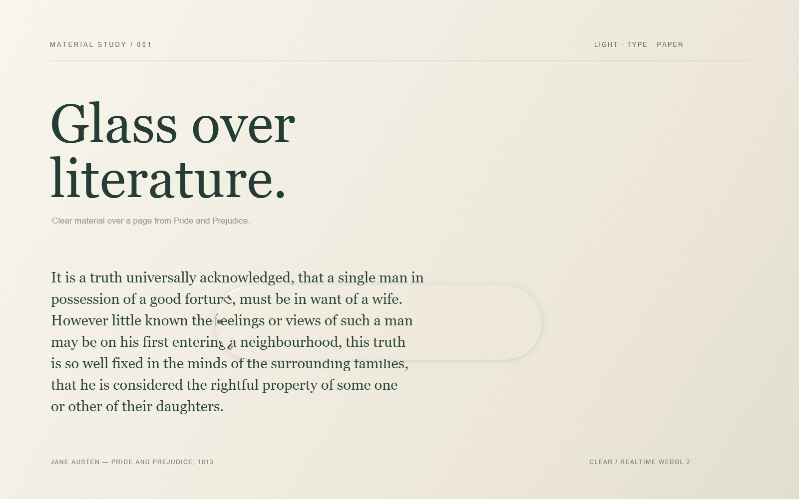
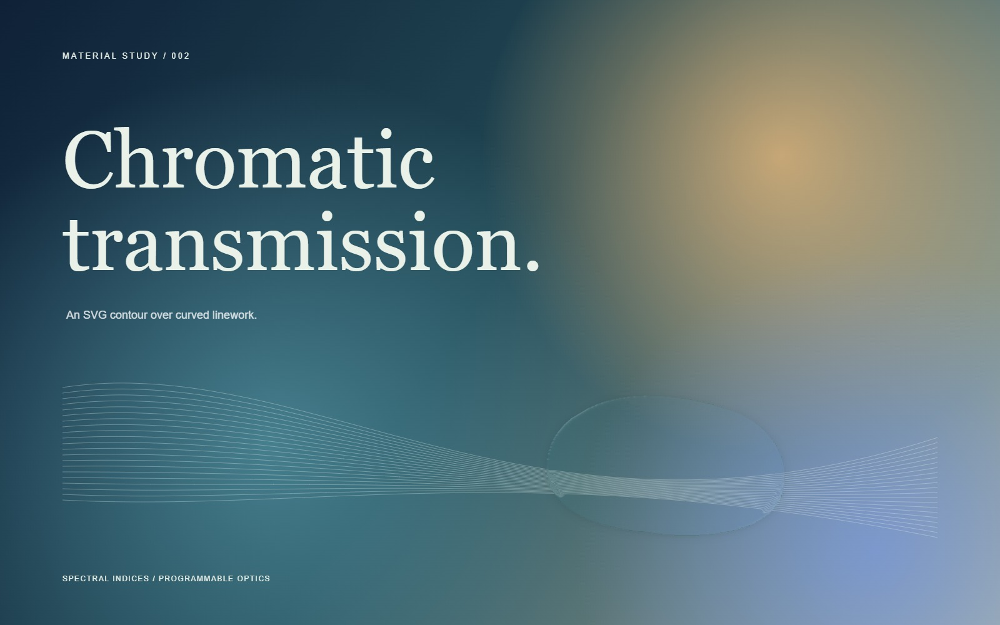
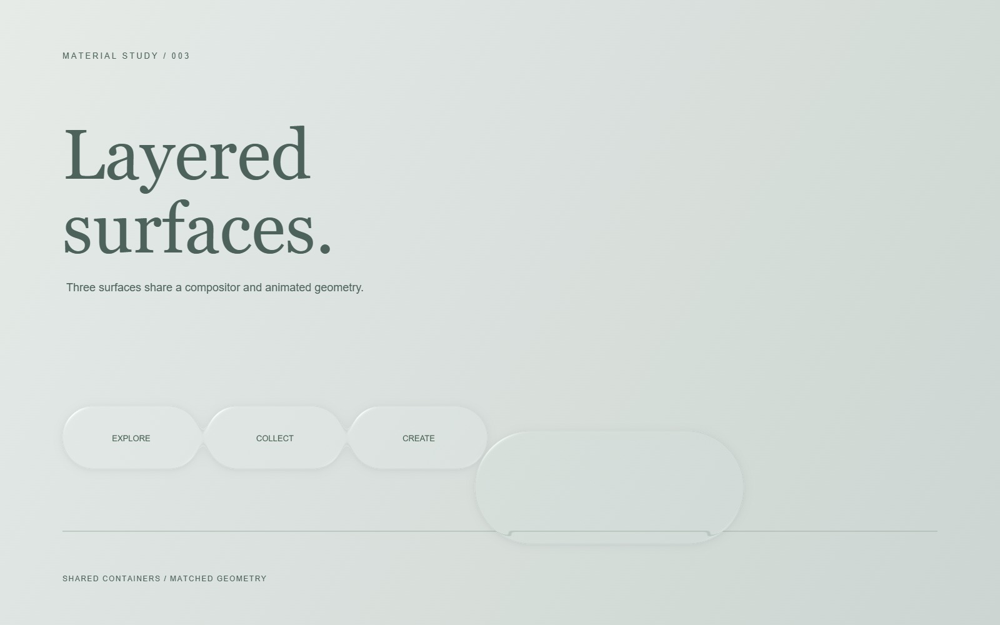
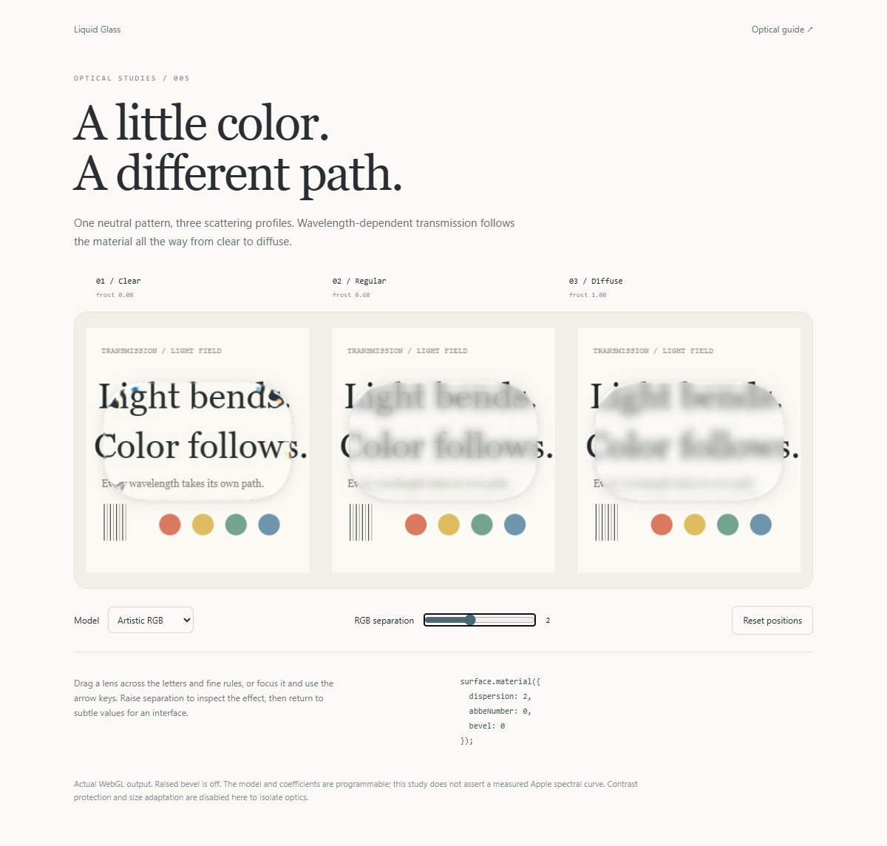
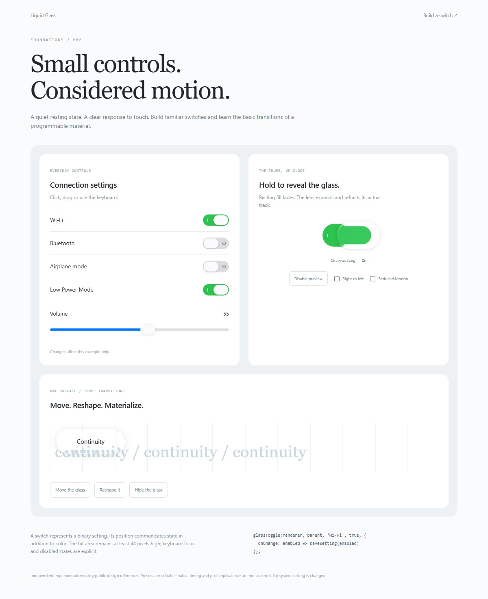
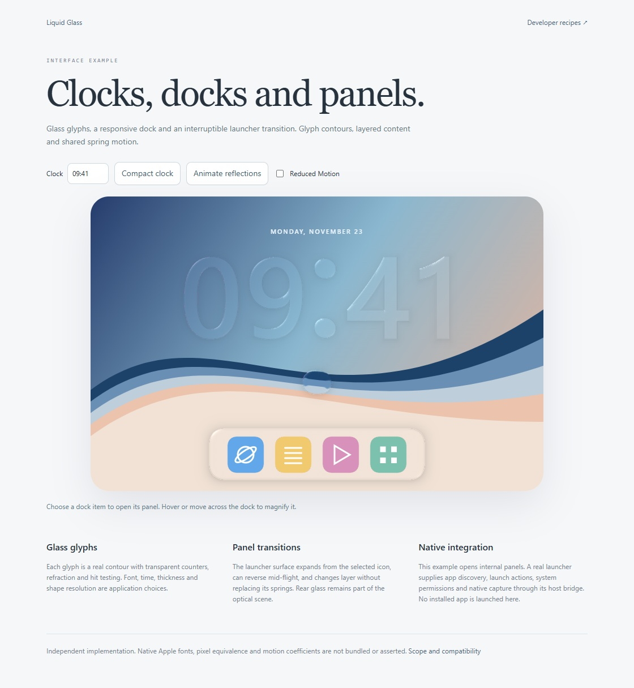

<div align="center">

# Liquid Glass Material

**A programmable material for light, motion and interface glass.**

[Live examples](https://golodgolub-bit.github.io/liquid-glass-material/examples/index.html) · [Documentation](docs/index.md) · [API](docs/api.md) · [Download](https://github.com/golodgolub-bit/liquid-glass-material/releases/latest) · [Compatibility](docs/apple-audit.md)



TypeScript · WebGL 2 · Zero runtime dependencies · MIT

</div>

A shared GPU compositor for refractive surfaces, layered content and fluid controls. Build for the web, Electron, Windows WebView2 and Android WebView. Configure the material or replace its GLSL and physics entirely.

## Capabilities

- **Optics:** independent thickness and refraction reach, glass/outside indices, magnification, Cauchy/Abbe RGB dispersion and Beer–Lambert absorption.
- **Finish:** Regular, Clear and Identity; composited contrast, tint, size response, scattering, directional light and independent environment reflection. Raised bevel is off by default.
- **Composition:** glass refracts completed rear glass and local content. Shared contours merge; SVG paths support free shapes, concavity, holes and interrupted morphs.
- **Motion:** namespaced effect identities, unions, matched geometry, materialize transitions, configurable analytic springs, impulses and custom deformation.
- **Interaction:** real grab/drag, selection lenses, hover/focus highlights, accessible controls, keyboard input and live accessibility preferences.
- **Response:** conservative per-pixel RGB range probes, bounded Regular protection, auto ink for Clear, independent edge light and geometry-driven optical depth.
- **Extension:** optics/field/shade hooks, complete fragment/scattering/background passes and typed uniforms with transactional compilation and context restoration.

## Material studies

<table><tr><td width="50%"><br><b>Chromatic light</b> — a free contour, spectral indices and an unembossed finish.</td><td width="50%"><br><b>Living interfaces</b> — shared materials, stable identities and composited layers.</td></tr></table>

These images are actual output of the included [gallery](examples/gallery), captured with the production material. The paper study uses Jane Austen's public-domain *Pride and Prejudice* (1813). Regenerate the images with `npm run capture:gallery` while the demo server is running.



The [optical study](examples/dispersion) compares clear and scattered transmission. This illustration uses separation 2 for inspection; the default is 0.35.

## Build familiar controls

Start with [Quick start](docs/quick-start.md), [Basic controls](docs/basic-controls.md), [Switches](docs/switches.md) and [Animation basics](docs/animation-basics.md). The switch and slider render their real rails beneath a dense resting thumb that becomes refractive during interaction.



## HTML distribution

Download the [offline HTML archive](https://github.com/golodgolub-bit/liquid-glass-material/releases/download/v0.11.0/liquid-glass-examples-0.11.0.zip), extract it and open `index.html`. To build it yourself, run `npm run build:html`. Each interactive page embeds its JavaScript and CSS. The same folder can be uploaded to a static HTTPS host. All demos compile from the current source. See [Publishing](docs/portable-html.md).

[Clocks and docks](docs/interface-recipes.md) · [Themes](docs/themes.md) · [Native launchers](docs/native-launchers.md) · [Apple matching](docs/apple-matching.md)



## Run the examples

```sh
npm ci
npm run dev
```

Open the local address printed by Vite for the laboratory and motion studio. For portable files, run `npm run build:html` and open `dist-html/index.html`. Additional routes:

| Route | Purpose |
|---|---|
| `/examples/interface-kit/` | Glass glyphs, dock magnification and launcher transitions |
| `/examples/controls/` | Switches, slider and move/reshape/reveal foundations |
| `/examples/gallery/` | Interactive paper, typography and chromatic studies |
| `/examples/dispersion/` | Draggable Clear/Regular/diffuse lenses and wavelength controls |
| `/examples/readability/` | Rear-content contrast, Clear presets and size/edge response |
| `/examples/reference/` | Fixed optical fixture with an optional native SwiftUI counterpart |
| `/examples/workbench/` | Live optics, physical springs and GLSL editor |
| `/examples/programmatic/` | Text recoloring, continuous motion and environment reflection |
| `/docs/` | Complete English developer guide |

## Add glass to an application

Download the `.tgz` from [Releases](https://github.com/golodgolub-bit/liquid-glass-material/releases/latest), then install it:

```sh
npm install ./liquid-glass-material-0.11.0.tgz
```

```ts
import { GlassRenderer, bindElement, observeSize } from '@liquid-glass/material';
import '@liquid-glass/material/style.css';

const renderer = new GlassRenderer(canvas);
const stopResize = observeSize(renderer);
renderer.setBackdrop(backgroundCanvas);

const buttonGlass = bindElement(renderer, button, {
  id: 'primary-action', radius: 24,
  material: { variant: 'regular', ior: 1.48, bevel: 0 }
});

// Later, during teardown:
buttonGlass.dispose();
stopResize();
renderer.dispose();
```

The background is explicit application input. For media, use `bindMediaBackdrop`; for selected text/icons, provide an aligned foreground mask. Native background capture requires a host bridge. See [Integration](docs/integration.md) and [Text under glass](docs/text-under-glass.md).

Read [Composited contrast](docs/readability.md) for foreground regions, conservative ratios and Clear backgrounds. [Material response](docs/material-response.md) explains size adaptation and independent edge controls.

## Coordinate related effects

```ts
const toolbar = new GlassEffectContainer(renderer, {
  namespace: 'toolbar', spacing: 24,
  transition: 'matchedGeometry', material: { variant: 'clear' }
});
await toolbar.reconcile([
  { id: 'edit', rect: { x: 20, y: 20, width: 90, height: 48, radius: 24 } },
  { id: 'share', rect: { x: 130, y: 20, width: 90, height: 48, radius: 24 } }
]);
```

Import `GlassEffectContainer` from the package. Stable IDs retain their springs as layout changes; a removed effect can be reintroduced during its exit. [Container guide →](docs/containers.md)

## Program the material

```ts
renderer.setShader(createGlassShader({
  uniforms: { uGlass_gain: { type: 'float', value: 1 } },
  optics: `
    GlassOpticalSample ray = defaultGlassOptics(data);
    ray.displacement *= uGlass_gain;
    return ray;
  `
}));
renderer.setShaderUniform('uGlass_gain', 0.8);
```

Import `createGlassShader` from the package. Uniform changes do not recompile the program; a compilation error preserves the previous working pipeline. [Shader and physics guide →](docs/programmability.md)

## Build and validate

```sh
npm run check          # TypeScript, unit tests and real browser checks
npm run build:demo     # Static gallery, lab and documentation
npm run build:hosts    # Prepare Windows / Android host assets
npm pack               # Installable ESM package and declarations
```

Install a test browser with `npx playwright install chromium`, or set `CHROMIUM_PATH`. Tests use one worker. [Validation](docs/validation.md) documents coverage; [Performance](docs/performance.md) contains hardware measurements and methodology. The renderer sleeps at rest; custom shaders and overlapping layers have their own cost.

## Compatibility

An independent implementation inspired by Apple Liquid Glass. It maps public material and transition concepts without depending on Apple's private code. Exact native shader/motion equivalence, HDR/EDR, native system composition and mobile GPU performance are not established. Windows and Android examples use WebView hosts; this is not a native WinUI or Compose renderer. See the [feature-by-feature compatibility guide](docs/apple-audit.md).

## License

[MIT](LICENSE). Gallery artwork is procedurally rendered; its literary excerpt is public domain. Apple, iOS and Liquid Glass are trademarks of Apple Inc. This project is not affiliated with Apple.

See [v0.9](docs/v0.9.md) for fine-detail contrast, spectral scattering and programmable selection lift. The [dispersion guide](docs/dispersion.md) explains complementary edge colors and the two optical models.

[v0.10](docs/v0.10.md) adds redesigned transient control thumbs, independent local-content opacity, minification and practical foundation guides.
