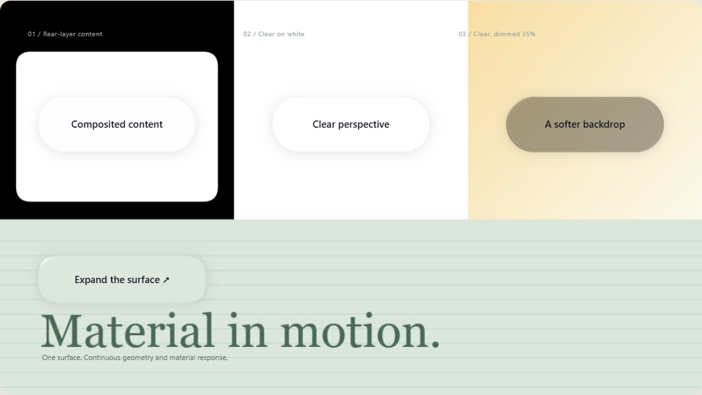

# Composited contrast

Foreground selection reads the rendered material, including completed rear glass and its local content. It does not rely on the original source image once a composited sample is available. The sample is taken before this surface's own local foreground is drawn, so a label cannot bias its own background estimate.



## Default behavior

Each visible surface contributes conservative RGB bounds from its foreground region. The default normalized region is `{x: 0.12, y: 0.18, width: 0.76, height: 0.64}`. The GPU first copies this rectangle 1:1 at render resolution, then reduces 4×4 blocks using component minima and maxima. Odd dimensions repeat the last pixel rather than dropping it. Reduction continues until both dimensions fit 32×32; separate lower/upper tiles retain every reduced cell. Regions up to 128×128 render pixels require one reduction draw. Each surface contributes at most 8 KiB to the readback atlas. No source pixel in the captured rectangle is skipped or linearly averaged away. Browser regressions cover 1–2 pixel lines and isolated single pixels.

Regular chooses light or dark ink and, when needed, adds neutral protection to the material. The solver uses luminance bounds, a 4.5:1 target and a maximum protection opacity of 0.85. Protection increases immediately when a completed sample requires it and decreases using the material spring. Increased Contrast raises the target to 7:1. The reported ratio is a conservative lower bound for the last captured region and the supplied canonical ink, including intermediate luminances. Component extrema can combine unrelated colors and understate actual contrast. This is not a WCAG conformance guarantee for custom glyphs, custom ink, uncaptured layers or subsequent animation frames.

Clear automatically chooses ink by default but never adds Regular's protection. A mixed photograph may offer no readable single ink color. Supply an appropriate background, explicit dimming, or a different material. `materials.clearDimmed` supplies Clear with `dimming: 0.35`; this is an integration preset, not a native Apple constant or a universal contrast guarantee.

## Configure the foreground region

```ts
const glass = renderer.addSurface({
  id: 'caption',
  rect: { x: 40, y: 60, width: 280, height: 100, radius: 30 },
  contrast: {
    appearance: 'auto',
    region: { x: 0.15, y: 0.25, width: 0.7, height: 0.5 },
    minimumRatio: 4.5,
    protection: 0.85
  }
});
const measured = await glass.contrastReady();
caption.style.color = glass.foreground;
console.log(measured?.ratio, measured?.meetsTarget);
```

Keep the region inside the part occupied by the foreground. A rectangle that includes the refracting boundary, uncovered corners or unrelated imagery can require more protection than the label needs. Regions use undeformed local rectangle coordinates and are clipped to the viewport. Nonrectangular shapes still use a rectangular sample region; choose an interior region for concave contours.

`contrast.appearance: 'light'` means light **ink**; `'dark'` means dark ink. `'material'` follows `GlassMaterial.appearance`: a light material appearance uses dark ink and vice versa. The material's default `appearance: 'auto'` lets the solver choose. `'auto'` in the contrast policy chooses ink independently of an explicit material appearance.

`glass.contrast({minimumRatio: 7})` updates the current policy. `glass.contrast(false)` disables the composited solver and protection for this group. `new GlassRenderer(canvas, {readability: false})` disables the subsystem globally. The older coarse source estimate remains a provisional fallback before the first completed sample and when composited sampling is disabled. `foreground` is a discrete ink color; it does not animate through low-contrast gray.

## State, latency and groups

`glass.state.contrast` contains `foreground`, `source`, `ratio`, `minimumRatio`, `meetsTarget` and current `protection`. A ratio is bounded by the last completed GPU reduction, not predicted from a target opacity. `meetsTarget` concerns that captured region and canonical ink only. The current `protection` can already be changing toward a correction while the ratio still describes the previous captured image. Source/geometry changes can precede a new measurement by the configured sampling interval plus GPU fence latency. `contrastReady()` waits for a completed measurement and any required correction; it resolves `null` when disabled, hidden or removed. Do not call it every frame. Refresh DOM ink in a renderer subscription, or use the supplied DOM bindings.

Union members share material and foreground policy. Their sampled regions are evaluated together; each member can specify its own initial region. Later `contrast(...)` calls apply the updated policy to the group. Incompatible policies in an existing union are rejected on insertion.

The GPU copies extrema tiles into a small RGBA8 atlas. One shared native-resolution workspace and two reusable ping-pong reduction targets serve all surfaces, rather than retaining a full-resolution snapshot for each one. Reduction uses nearest texel access, no blending and no dithering. Scratch storage and reduction draws are included in texture/draw statistics. After retrieval, component bounds are collapsed to two RGB values per surface before the solver, avoiding hundreds of normalized temporary arrays. One pixel-pack buffer and fence transfer the atlas asynchronously; CPU retrieval happens only after the fence signals. There is no blocking fence wait. During continuous changes, probes are limited to 15 Hz by default (`RendererOptions.contrastInterval: 1000 / 15`, in milliseconds). Set zero to sample every dirty frame, or raise the interval to reduce readback cost. Geometry and optical animation continue at the presentation rate. Initial capture, required stronger protection and explicit `contrastReady()` requests bypass this interval. Fence latency still applies; a completed probe for an older background cannot satisfy a new readiness request. Work is invalidated by changes and stops at rest. `renderer.stats.contrastCopies` and `contrastReadbacks` are cumulative counters. Polling a pending fence may require additional animation frames. `renderer.idle` stays false until those probes and scheduled frames finish; use it to establish an idle baseline before recording counters.

## Custom shading and limitations

The standard shader applies `uniform vec4 readability` as a neutral RGB/opacity protection layer after `glassShade`. Template hooks retain this final stage. A full replacement fragment must preserve this active uniform to use Regular protection; otherwise the solver measures its pixels but cannot correct them. The compositor approximately removes the previous protection from sampled RGB when solving the next correction; RGBA8 quantization limits precision.

The probe includes only content available to this WebGL compositor. Uncaptured DOM/native layers cannot affect it. A translucent overlay renderer also cannot inspect the page behind its canvas: supply the same composited background through the backdrop integration. Own foreground content is deliberately excluded, while foreground from completed lower layers is included. Fine-detail RGB ranges are preserved at the rendered resolution, but partial occlusion, rapid changes, offscreen content and custom GLSL still require application-level checks. The renderer cannot recover source detail already lost during backdrop scaling or scattering.

Run `/examples/readability/` for the rear-content regression, Clear presets, live edge controls and size response. See [Integration](integration.md), [Text under glass](text-under-glass.md) and [Validation](validation.md).

## Supply bounds from another compositor

```ts
const policy = createContrast({ minimumRatio: 4.5 });
const result = evaluateContrastBounds({
  minimum: [0.02, 0.01, 0.03], maximum: [0.98, 0.97, 1]
}, policy);
```

Bounds must contain finite normalized RGB minima/maxima with minimum ≤ maximum per component. The helper applies the same ink/protection solver to a conservative range, without GPU access. It cannot verify that the supplied range covers the application content. Use `evaluateContrast` for explicit RGB samples.
