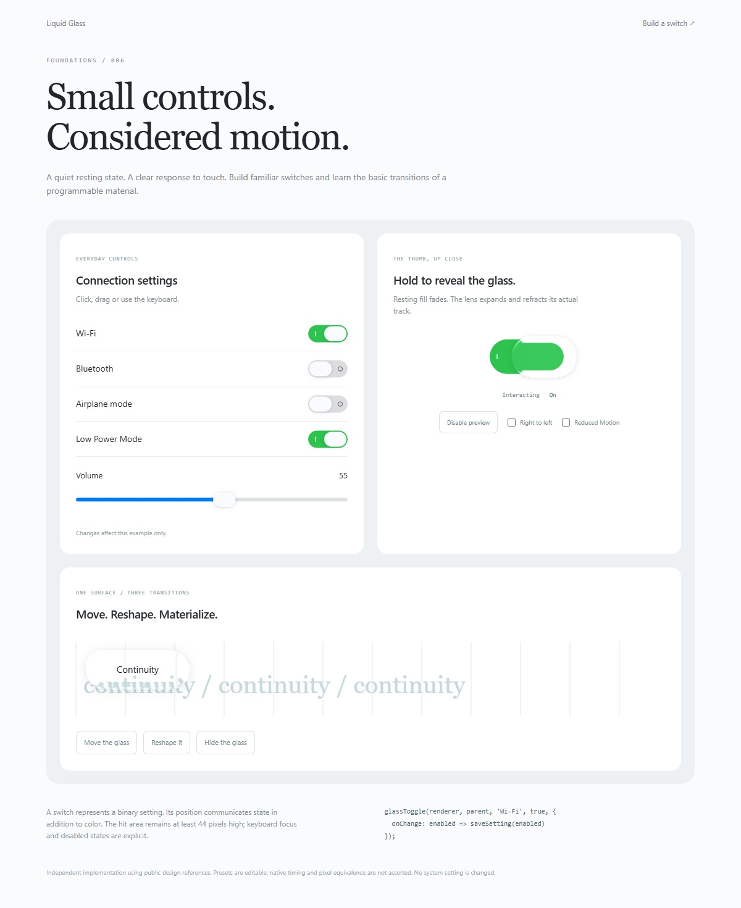

# Switches: from a dense thumb to glass

A switch needs a recognizable off state, a recognizable on state and direct manipulation between them. The default component uses a 64×28 CSS-pixel track, a 36×24 resting thumb and a 44-pixel minimum hit height. These are editable library dimensions, not a guarantee about every Apple platform's native point size.

Apple describes switch and slider thumbs as transient Liquid Glass elements during interaction: [Materials](https://developer.apple.com/design/human-interface-guidelines/materials), [Build a UIKit app with the new design](https://developer.apple.com/videos/play/wwdc2025/284/?time=1044). The portable component follows that public behavior while keeping its coefficients open.



## The three visual phases

| Phase | Intended appearance | Implementation |
|---|---|---|
| Resting | Compact light thumb; clear endpoint; quiet rail | Local light content at opacity 1 over the material |
| Holding / dragging | Thumb expands into a transparent lens; real track bends through it | Press springs, lower content opacity, stronger optical response and slight minification |
| Releasing | One coherent return to a dense thumb at the committed endpoint | Interrupted spring motion and material/content restoration |

The rail is an identity surface carrying a small procedural canvas. It is completed before the front thumb is drawn. This lets the thumb refract the actual green/neutral track, rather than an unrelated background. The DOM track is a transparent layout and focus target.

`magnification: 0.8` in the active profile slightly minifies transmitted content, leaving a clearer boundary around the compressed track. Glass effects do not always need to enlarge their background. `bevel` remains zero: the response does not depend on a raised decorative frame. The preset is independently selected, not a fitted native shader.

## Create a switch

```ts
const wifi = glassToggle(renderer, parent, 'Wi-Fi', true, {
  onChange: checked => savePreference('wifi', checked),
  accentColor: [0.18, 0.76, 0.31],
  onOffLabels: true
});
```

`checked` reads the committed value. `setChecked(value, animate = true)` changes it programmatically without emitting a user change. `setDisabled(value)` updates the native button's disabled state. You can also assign `element.disabled` directly. A disabled switch does not respond to user gestures.

The pointer begins without jumping the thumb to the contact location. Movement beyond a small threshold previews the value; release commits the nearest endpoint. A short tap toggles once. Cancellation or window blur returns to the previously committed value. Window routing keeps the gesture working when pointer capture fails or the pointer leaves the control. Keyboard Space/Enter toggles; arrows and Home/End also select endpoints. RTL reverses visual placement and arrow direction while preserving logical on/off state.

## Program the response

```ts
const setting = glassToggle(renderer, parent, 'Background updates', false, {
  material: { reflection: 0.15, refraction: 3 },
  activeMaterial: { refraction: 14, magnification: 0.8, frost: 0.04 },
  contentOpacity: 1,
  activeContentOpacity: 0.04,
  trackingSpring: { frequency: 14, damping: 1 },
  releaseSpring: { frequency: 4.2, damping: 0.92 },
  physics: {
    press: { frequency: 5, damping: 0.95 },
    pressScale: [0.46, 0.38],
    maxStretch: 0.1
  }
});
```

`contentOpacity` fades only the thumb's local content; it does not hide the refractive material beneath it. Material fields and content opacity use interruptible springs. Tracking and release geometry use separate profiles. The returned `surface` and `trackSurface` expose the normal programmable renderer API; the controller restores its configured resting/active profile when interaction phases change.

For a controlled visual demonstration:

```ts
setting.setPressed(true);
setting.setChecked(true);
await setting.surface.settled();
setting.setPressed(false);
```

`setPressed` controls the visual phase only. It does not synthesize input or commit a value. Prefer the built-in DOM gesture handling for ordinary interaction.

## Size and theme

Set CSS dimensions before constructing the component:

```css
.large-switch .lg-toggle {
  --lg-switch-width: 128px;
  --lg-switch-height: 56px;
  --lg-switch-thumb-width: 72px;
  --lg-switch-inset: 4px;
}
```

The example enlarges all dimensions uniformly so the optical response is easy to inspect. Use normal-sized controls in application settings. Colors are normalized sRGB triples: `accentColor`, `offColor` and `thumbColor`. An explicit `content` source replaces the default light thumb cap. Keep `.lg-toggle-track` and `.lg-toggle-thumb` backgrounds transparent so DOM fills do not cover the GPU material.

## Accessibility and review

Reduced Motion snaps geometry and suppresses elastic deformation. Reduced Transparency keeps the thumb's local fill opaque during interaction. Increased Contrast enables on/off marks. The state is also expressed through `role="switch"`, an accessible label and `aria-checked`; the on/off position provides a non-color visual cue.

Before shipping, test both endpoints, cancellation, a drag beyond the hit area, keyboard focus, disabled state, RTL and live accessibility changes. Inspect the control over light/dark content at the intended DPR. Motion constants, spectral response and native timing equivalence remain unmeasured. See [Validation](validation.md) for the automated coverage and [Performance](performance.md) for compositor limits.
